# HUST Search — Báo cáo bài tập lớn Tìm kiếm thông tin

> Cấu trúc file: **PHẦN A** = nội dung từng slide (20 slide chính) · **PHẦN B** = phụ lục (P1–P5) · **PHẦN C** = kịch bản thuyết trình theo từng slide.
> Template: `docs/slide/_template.pptx` (layout: Title Slide / Title Only / Two Content / OBJECT / Blank). Mỗi slide ghi gợi ý layout ở dòng `Layout`.
> Ảnh dùng: `docs/images/ui/*`, `docs/images/db_schema/*` · Sơ đồ UML (PlantUML): `docs/slide/diagrams/*.puml` → `*.png` (dùng chung `style.iuml`) · Biểu đồ phân tích: `docs/slide/charts/*.png` (sinh bởi `docs/slide/analysis/`).
> Các số liệu lấy từ repo tại thời điểm 31/10/2026 (xem mục "Nguồn số liệu" cuối PHẦN A).

---
---

# PHẦN A — NỘI DUNG SLIDE

---

## Slide 1 — Trang bìa
**Layout:** Title Slide

# HUST Search
### Hệ thống thu thập, lập chỉ mục và tìm kiếm thông tin trên website `hust.edu.vn`

- Học phần: Tìm kiếm thông tin (Information Retrieval)
- Giảng viên: *[Tên thầy]*
- Nhóm: *[Số nhóm]* — *[Họ tên – MSSV các thành viên]*
- Công nghệ: Java 21 · Spring Boot 3.5 · Apache Lucene 9.12 · MongoDB · Jsoup · Apache Tika · Tesseract OCR

---

## Slide 2 — Bài toán & mục tiêu
**Layout:** Two Content

**Bài toán**
- Website ĐHBK Hà Nội (`hust.edu.vn`) và các tên miền con có lượng nội dung rất lớn, phân tán: tin tức, thông báo, văn bản, tài liệu, thư viện số…
- Nội dung không chỉ là HTML: còn **PDF, Word, ảnh chứa chữ** (logo, thông báo scan).
- Người dùng cần tìm theo **từ khóa tiếng Việt** (có thể gõ không dấu).

**Mục tiêu của nhóm**
1. Xây dựng **crawler** thu thập có kiểm soát trong phạm vi `*.hust.edu.vn`.
2. **Trích xuất nội dung sạch** từ nhiều loại tài nguyên (HTML / PDF / DOC / ảnh).
3. Xây dựng **chỉ mục ngược (inverted index)** bằng Lucene với analyzer tiếng Việt tự viết.
4. Cung cấp **giao diện tìm kiếm** và **so sánh 2 chiến lược**: *Full-document* vs *Chunk-based*.

**Phạm vi:** hệ thống nhỏ, chạy đơn máy, mục đích học tập/nghiên cứu.

---

## Slide 3 — Kiến trúc tổng quan
**Layout:** Title Only (vẽ sơ đồ)

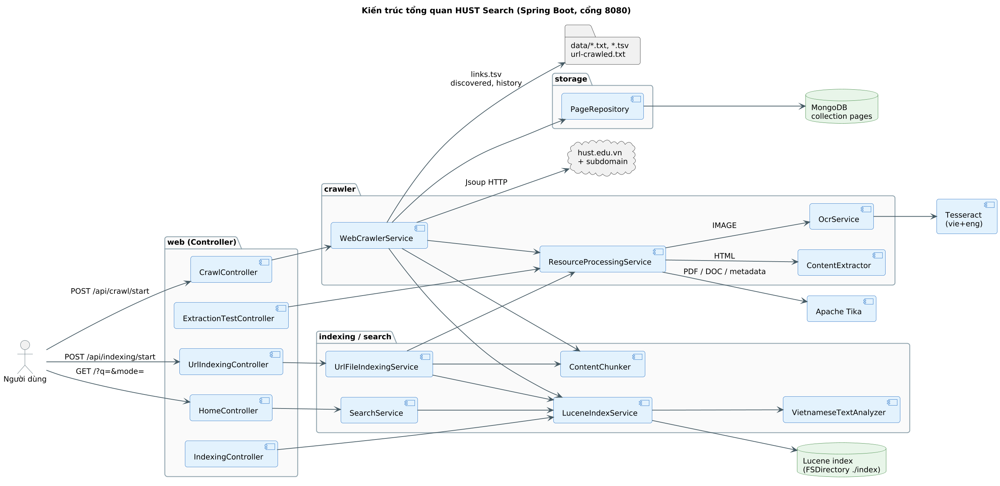

*Sơ đồ thành phần — `diagrams/01_architecture.puml`*


**Điểm nhấn:** 3 lớp tách bạch — *Thu thập* → *Xử lý/Lưu trữ* → *Lập chỉ mục/Tìm kiếm*; toàn bộ là một ứng dụng Spring Boot (cổng 8080).

---

## Slide 4 — Công nghệ & cấu trúc mã nguồn
**Layout:** Two Content

| Thành phần | Công nghệ | Vai trò |
|---|---|---|
| Web/MVC | Spring Boot 3.5.6, Thymeleaf | REST API + giao diện |
| Crawl HTTP, parse HTML | Jsoup 1.21.2 | Tải trang, trích link, DOM |
| Tài liệu PDF/Word | Apache Tika 3.2.2 | Trích văn bản + metadata |
| OCR ảnh | Tess4J 5.16 + Tesseract (`vie`, `eng`) | Đọc chữ trong ảnh |
| Lưu trữ gốc | MongoDB (Spring Data) | Collection `pages` |
| Chỉ mục & truy vấn | Apache Lucene 9.12.2 | Inverted index, ranking |

**Cấu trúc package `vn.hust.ir` (≈ 3.500 dòng, 18 file Java + 1 template)**
- `crawler/` — `WebCrawlerService` (723 dòng), `ContentExtractor`, `ResourceProcessingService`, `OcrService`, `CrawlExecutorConfig`
- `indexing/` — `LuceneIndexService`, `ContentChunker`, `UrlFileIndexingService`
- `text/` — `VietnameseTextAnalyzer`
- `search/` — `SearchService`
- `storage/` — `PageDocument`, `PageRepository`
- `web/` — 5 controller (Home, Crawl, Indexing, UrlIndexing, ExtractionTest)

---

## Slide 5 — Crawler (1): Thuật toán BFS có kiểm soát
**Layout:** Two Content

**Thuật toán (`WebCrawlerService.crawl()`)**
1. Nạp `url-crawled.txt` (đã crawl) + `data/url-discovered.txt` (đã phát hiện); thêm seed `https://hust.edu.vn/`.
2. Hàng đợi **`ArrayDeque` — duyệt theo chiều rộng (BFS)**: `removeFirst()` / `addLast()`.
3. Mỗi URL: bỏ qua nếu *trùng lượt chạy* · *đã crawl* · *ngoài miền*.
4. Tải trang → xử lý → lưu → lập chỉ mục → trích link mới → đẩy vào hàng đợi.
5. Dừng khi hết hàng đợi hoặc đạt `max-pages-per-run = 1000`.

**Giới hạn phạm vi**
- `isAllowedDomain`: host `== hust.edu.vn` hoặc kết thúc bằng `.hust.edu.vn`.
- Kiểm tra lại **sau redirect** (URL cuối phải còn trong miền).

**Chuẩn hóa URL (`normalizeUrl`)** — để khử trùng lặp
- chữ thường scheme/host; bỏ cổng mặc định 80/443; bỏ fragment `#…`
- loại tham số tracking `utm_*`, `fbclid`, `gclid`
- chỉ nhận `http/https`; từ chối URL có userinfo

**Có thể dừng/tiếp tục:** trạng thái lưu ra file nên chạy lại không crawl lặp.

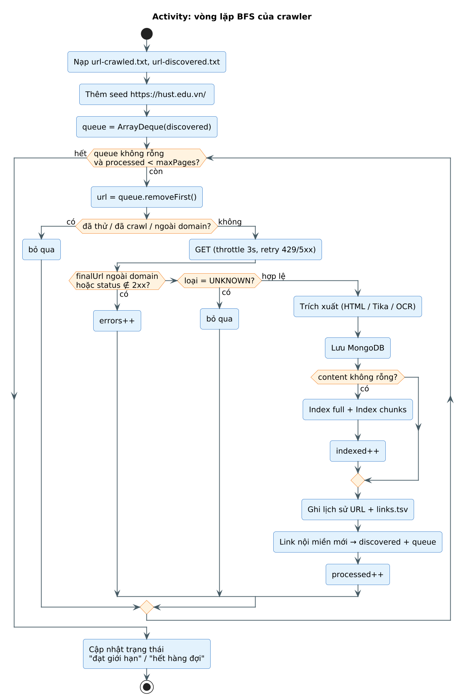

*Activity diagram — `05_activity_crawler.puml` (đặt cạnh cột trái khi dàn slide)*

---

## Slide 6 — Crawler (2): Lịch sự & bền bỉ (politeness / resilience)
**Layout:** Two Content

**Lịch sự với máy chủ**
- `request-delay-ms = 3000`: **tối thiểu 3 giây giữa 2 request** (đồng bộ bằng `synchronized` + `lastRequestTime`).
- User-Agent tự khai báo: `HUSTInformationRetrievalBot/1.0 (academic research crawler)`.
- Executor **1 luồng duy nhất** (`core = max = 1`, queue = 1) → không thể crawl song song vượt kiểm soát.

**Xử lý lỗi**
- `429` hoặc `5xx` → thử lại tối đa `max-retries = 3`.
- **Exponential backoff:** `delay = 5000 ms × 2^(lần-1)`; tôn trọng header `Retry-After` nếu lớn hơn.
- Timeout 20 s, `maxBodySize` 100 MB, theo dõi redirect, `ignoreHttpErrors` để tự xử lý mã trạng thái.
- Lỗi 1 URL **không làm dừng** cả phiên: tăng bộ đếm `errors`, tiếp tục.

**Giám sát**
- `POST /api/crawl/start` · `GET /api/crawl/status` → `{running, processed, indexed, errors, limit, message}`.
- UI poll trạng thái, hiển thị thanh tiến độ.

> *Hạn chế (nói thẳng):* chưa đọc `robots.txt` — dựa vào rate-limit + UA. Xem Slide 18.

---

## Slide 7 — Xử lý đa định dạng tài nguyên
**Layout:** Title Only (bảng)

`ResourceProcessingService.detectType()` phân loại theo **MIME** rồi **đuôi file**:

| Loại | Nhận diện | Cách xử lý | Kết quả |
|---|---|---|---|
| **HTML** | `text/html`, `.html/.htm` | `ContentExtractor` (Jsoup) | title, ngày, tác giả, nội dung chính, link + ảnh/media nhúng |
| **PDF** | `application/pdf`, `.pdf` | Tika `AutoDetectParser` | text + metadata (tác giả, ngày tạo…) |
| **DOCUMENT** | docx/doc/rtf/odt | Tika | như PDF |
| **IMAGE** | `image/*`, jpg/png/gif/webp/… | Tika metadata + **Tesseract OCR `vie+eng`** | text trong ảnh; `ocrStatus = SUCCESS / NO_TEXT / FAILED` |
| UNKNOWN | còn lại | bỏ qua (`SKIP: UNSUPPORTED TYPE`) | — |

**Ví dụ thật từ MongoDB** (ảnh `docs/images/db_schema`):
- `logo-2-1.png` → OCR ra *"ĐẠI HỌC BÁCH KHOA HÀ NỘI / LANOI UNIVERSITY OF SCIENCE AND TECHNOLOGY"* (metadata: 31 trường).
- `…student_application_form_incoming_ss_1.docx` → title *"SOCRATES / ERASMUS"*, author, ngày tạo lấy từ metadata Tika (25 trường).
- Bài tin HTML → title, `publishDate = 2026-10-11T07:12:05+07:00`, author, **170 liên kết**.

---

## Slide 8 — Trích xuất nội dung chính từ HTML (`ContentExtractor`)
**Layout:** Two Content

**Vấn đề:** HTML chứa menu, footer, banner… làm nhiễu chỉ mục.

**Quy trình**
1. Lấy **metadata**: title (`og:title` → `twitter:title` → `<h1>` → `<title>`), ngày (`article:published_time`, `<time datetime>`…), tác giả (`meta[author]`, `[rel=author]`…).
2. Lấy **links** `a[href]` (URL tuyệt đối, bỏ `javascript:/mailto:/tel:`) + anchor text.
3. Clone DOM, **xóa** `script, style, noscript, svg, canvas, iframe, nav, footer, aside, form, button`.
4. Chọn **khối nội dung tốt nhất** bằng điểm số.
5. Fallback: nếu rỗng → lấy toàn `body`.

**Hàm chấm điểm (2 chiến lược, cấu hình `content-extraction-strategy`)**
```
score = ln(1 + độ_dài_text) + 2·#<p> + 1.5·#<h1-h3> − 12·link_density
```
- `DOM_HEURISTIC`: +5 nếu ≥3 đoạn `<p>`; −10 nếu link_density > 0.5.
- `READABILITY` *(mặc định)*: +15 `<article>`, +12 `<main>`/`role=main`, +8 nếu id/class chứa *article|content|post|entry|story*, **−15** nếu chứa *nav|menu|footer|sidebar|comment|related|breadcrumb|widget*.

**Ý tưởng cốt lõi:** nội dung chính = khối có *nhiều chữ, nhiều đoạn văn, ít link* (link density thấp).

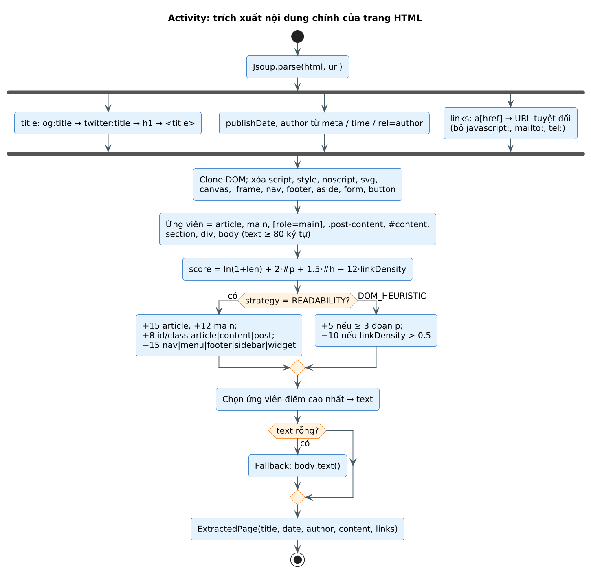

*`06_activity_extraction.puml`*

---

## Slide 9 — Lưu trữ dữ liệu
**Layout:** Two Content (trái: bảng, phải: ảnh `docs/images/db_schema/image(1).png`)

**MongoDB — collection `pages`** (`PageDocument`, `_id` = URL ⇒ ghi lại là *upsert*, không trùng)

| Trường | Ý nghĩa |
|---|---|
| `_id`, `url` | URL chuẩn hóa (khóa chính) |
| `title`, `author`, `publishDate` | metadata |
| `content` | văn bản đã trích |
| `contentType`, `resourceType` | MIME gốc · HTML/PDF/DOCUMENT/IMAGE |
| `links[]` | `{destinationUrl, anchorText}` (đã khử trùng theo URL đích) |
| `metadata{}` | metadata Tika / OCR / kích thước |
| `crawledAt` | thời điểm crawl |

**Tệp phẳng hỗ trợ**
| File | Nội dung | Quy mô hiện có |
|---|---|---|
| `data/links.tsv` | đồ thị liên kết `nguồn ⇥ đích ⇥ anchor` | 21.760 cạnh · 752 URL đích duy nhất |
| `data/url-discovered.txt` | URL đã phát hiện (frontier) | 760 URL |
| `url-crawled.txt` | lịch sử URL đã crawl / danh sách nạp sẵn | 101.756 URL · 118 host |

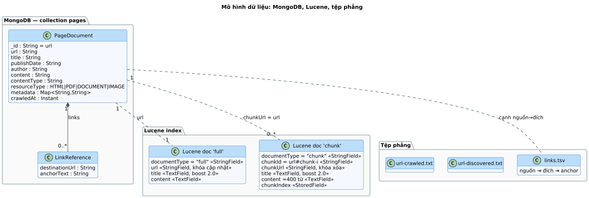

*`09_data_model.puml` — quan hệ giữa bản ghi Mongo, 2 loại document Lucene và các tệp phẳng*

**Vì sao tách MongoDB và Lucene?** MongoDB giữ *bản gốc đầy đủ* (có thể lập chỉ mục lại bất cứ lúc nào); Lucene chỉ giữ cấu trúc phục vụ *tìm kiếm*.

---

## Slide 10 — Bộ phân tích văn bản tiếng Việt (`VietnameseTextAnalyzer`)
**Layout:** Two Content

**Pipeline tự cài đặt (kế thừa `Analyzer`, `Tokenizer` riêng)**
```
"Đại học Bách khoa"
   │ ① lower-case + đ→d
   │ ② Unicode NFD + bỏ dấu (\p{M})      → "dai hoc bach khoa"
   │ ③ tách từ bằng regex [\p{L}\p{N}]+  → dai | hoc | bach | khoa
   │ ④ sinh BIGRAM kề nhau (nối "_")
   ▼
 dai, dai_hoc, hoc, hoc_bach, bach, bach_khoa, khoa
```

**Lý do thiết kế**
- **Bỏ dấu:** người dùng gõ *"dai hoc bach khoa"* vẫn khớp *"Đại học Bách khoa"*; chịu được lỗi gõ dấu/Unicode dựng sẵn–tổ hợp.
- **Bigram thay cho tách từ tiếng Việt:** tiếng Việt viết cách chữ nên "học" ≠ "đại học". Bigram giữ được cụm 2 âm tiết (*bách khoa, tuyển sinh, trí tuệ*) **mà không cần thư viện tách từ (VnCoreNLP…)**.
- **Cùng một analyzer** cho cả lúc *index* và lúc *query* → token luôn khớp.

**Đánh đổi:** mất dấu ⇒ mất khả năng phân biệt từ đồng âm khác dấu (*ma/má/mà*); index lớn hơn (~2× token).

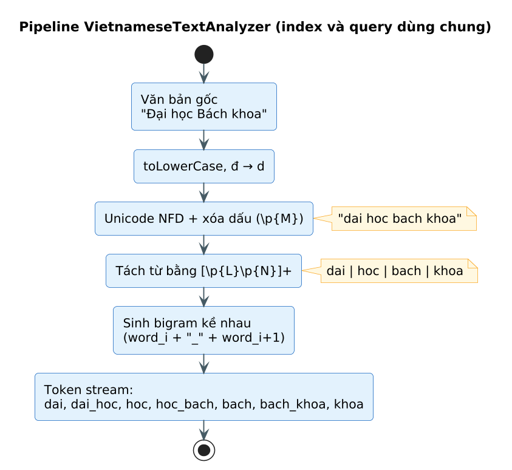

**Đã kiểm chứng trên chỉ mục mẫu (159 trang):** truy vấn `đại học bách khoa` và `dai hoc bach khoa` cho **danh sách URL và điểm số giống hệt nhau** (cả 2 chế độ).
**Số liệu từ vựng:** 80.311 term — 13.279 unigram (17%) + 67.032 bigram (83%) → xem biểu đồ ở Phụ lục P7.

---

## Slide 11 — Lập chỉ mục Lucene: 2 chiến lược
**Layout:** Two Content

**Cùng một chỉ mục, hai loại tài liệu (phân biệt bằng trường `documentType`)**

| | **Full-document** | **Chunk-based** |
|---|---|---|
| `documentType` | `"full"` | `"chunk"` |
| Đơn vị lập chỉ mục | cả trang | đoạn ~400 từ |
| Khóa | `url` (`StringField`) | `chunkUrl` + `chunkId = url#chunk-i` |
| Trường văn bản | `title`, `content` (`TextField`, stored) | `title`, `content`(= chunk), `chunkIndex` |
| Cập nhật | `updateDocument(Term("url"))` → thay thế | `deleteDocuments(Term("chunkUrl"))` rồi thêm lại |

**Chunking (`ContentChunker`)**: cửa sổ trượt **400 từ, chồng lấn 50 từ** (`start = end − 50`); trang ≤ 400 từ → 1 chunk.

**Vì sao chunk?** Trang dài (PDF, tin dài) làm *độ dài trường* tăng ⇒ chuẩn hóa độ dài của TF-IDF phạt nặng; chunk giúp **tìm đúng đoạn liên quan** và snippet chính xác hơn. Overlap tránh cắt mất cụm từ ở ranh giới.

**Idempotent:** index lại cùng URL không sinh bản sao.

---

## Slide 12 — Truy vấn & xếp hạng
**Layout:** Two Content

**Phân tích truy vấn**
- `MultiFieldQueryParser` trên 2 trường **`title` (boost ×2.0)** và **`content` (×1.0)**.
- Toán tử mặc định **OR** → ưu tiên *recall*; tài liệu khớp nhiều từ/bigram hơn ⇒ điểm cao hơn.
- `escape(queryText)` → chống ký tự đặc biệt của cú pháp Lucene.
- `BooleanQuery`: `textQuery` **MUST** + `documentType` **FILTER** (lọc không tính điểm).

**Mô hình xếp hạng: `ClassicSimilarity` (TF-IDF vector-space)**
```
score(q,d) = coord(q,d) · queryNorm(q) · Σ_t [ tf(t,d) · idf(t)² · boost(t) · norm(t,d) ]
tf = √freq ,  idf = 1 + ln((N+1) / (df+1)) ,  norm = 1/√(số_term_trong_trường)
```
Giao diện hiển thị nhãn **TF-IDF** và điểm của mỗi kết quả.

**Hậu xử lý (chunk mode)**
- Lấy ứng viên `min(1000, limit×10)` rồi **gộp theo URL, giữ chunk điểm cao nhất**, cắt còn 20 kết quả.
- **Snippet:** tìm cụm truy vấn (đã chuẩn hóa bỏ dấu) trong nội dung, cắt cửa sổ −80/+160 ký tự; không thấy thì lấy 240 ký tự đầu.

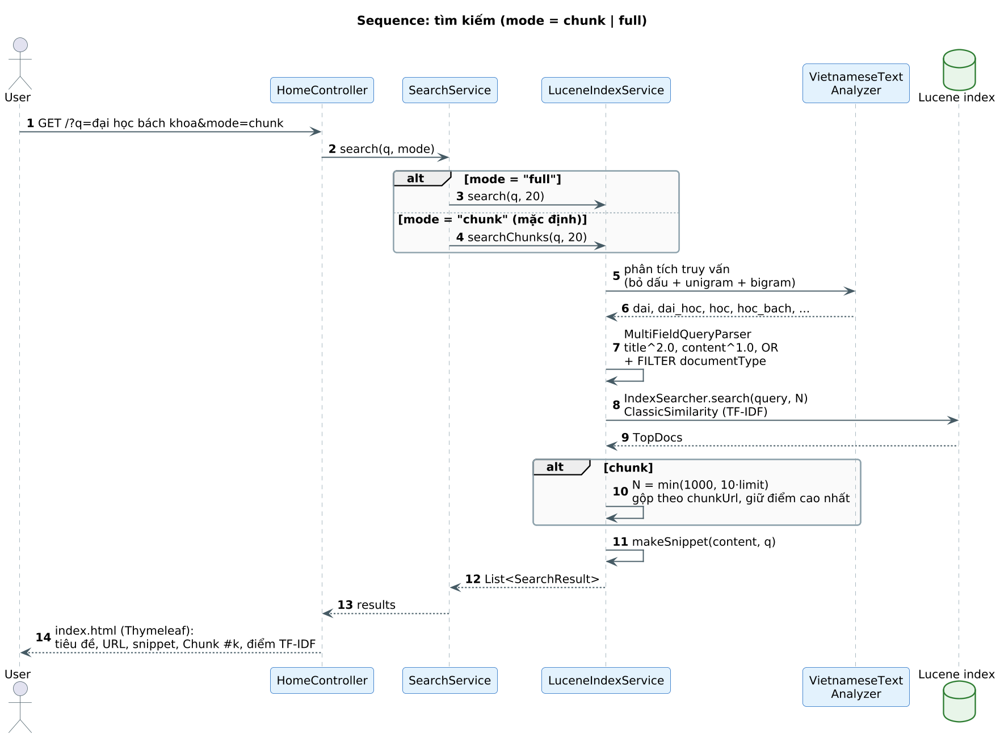

*`04_sequence_search.puml`*

---

## Slide 13 — Luồng nạp dữ liệu (Ingestion pipeline)
**Layout:** Title Only (sơ đồ lớn)

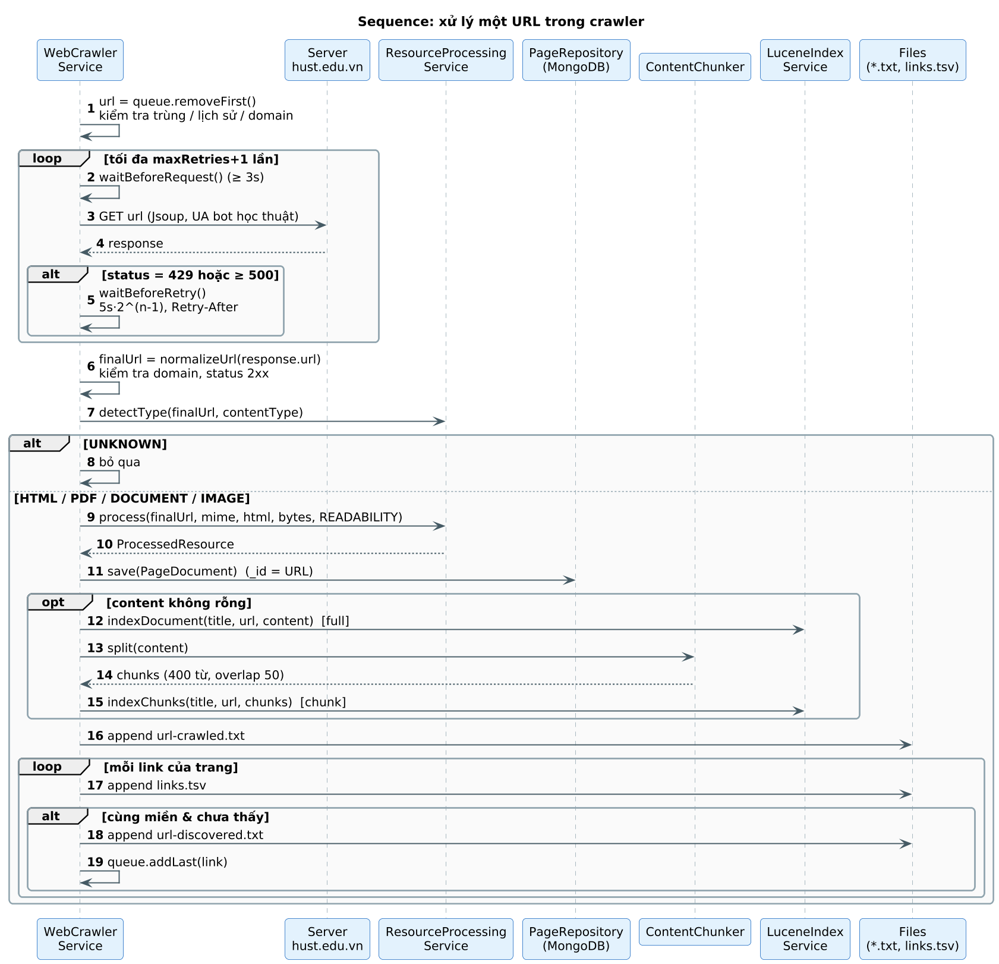

*`03_sequence_crawl.puml`*

**Mỗi URL:** throttle 3s → GET (retry/backoff) → kiểm tra domain/status/type → xử lý theo định dạng → **① MongoDB** → **② Lucene full** → **③ chunk + Lucene chunk** → **④ lịch sử** → **⑤ links.tsv + hàng đợi**.

**Hai chế độ nạp:** (1) *Crawler website* — khám phá từ seed (≤ 1.000 URL/lượt); (2) *Nạp URL có sẵn* — đọc `N` URL đầu của `url-crawled.txt` (10 → 1.000), dựng nhanh chỉ mục mẫu.
**Chỉ index khi `content` không rỗng.** Log có cấu trúc: `[HTTP]`, `[RESOURCE]`, `[INDEXED]`, `[LINK SUMMARY]`, `[CRAWLER SUMMARY]`.

---

## Slide 14 — API & Giao diện người dùng
**Layout:** Two Content (ảnh `docs/images/ui/image.png`)

**REST API**
| Endpoint | Chức năng |
|---|---|
| `GET /?q=…&mode=chunk\|full` | Trang tìm kiếm (Thymeleaf) |
| `POST /api/crawl/start` · `GET /api/crawl/status` | Điều khiển / theo dõi crawler |
| `POST /api/indexing/start?limit=N` · `GET …/status` | Nạp URL có sẵn (1–1000) |
| `POST /api/index` | Index thủ công 1 tài liệu `{title,url,content}` |
| `POST /api/test-extraction/upload` · `GET …/url?url=` | Thử trích xuất 1 file/URL bất kỳ |

**Giao diện "HUST Search" gồm 3 khối**
1. *Nạp URL có sẵn* — chọn số URL, thanh tiến độ (đã xử lý / đã lập chỉ mục / lỗi).
2. *Crawler website* — nút chạy nền + thống kê trực tiếp.
3. *Tìm kiếm & so sánh phương pháp* — ô tìm kiếm, **công tắc Full-document ⇄ Chunk-based**, truy vấn gợi ý (*trí tuệ nhân tạo, tuyển sinh đại học, nghiên cứu khoa học*).

**Mỗi kết quả:** tiêu đề · URL · snippet · nhãn `Chunk #k` · điểm TF-IDF.

---

## Slide 15 — Demo & kết quả thực tế
**Layout:** Title Only (ảnh lớn `docs/images/ui/image(3).png` + `image(2).png`)

**Crawler đang chạy (ảnh chụp):** đã xử lý 165 · đã lập chỉ mục 151 · lỗi 9 (≈ 5,5% lỗi), đang xử lý ảnh `…/uploads/sys/news/2026_09/image_8.png`.

**Truy vấn: "đại học bách khoa" — chế độ Chunk-based → 20 kết quả**
| # | Kết quả | Chunk | Điểm |
|---|---|---|---|
| 1 | Đại học Bách khoa Hà Nội (`hust.edu.vn/`) | #4 | 11,3197 |
| 2 | Chào mừng kỷ niệm 70 năm thành lập ĐHBKHN | #2 | 7,3941 |
| 3 | Trung tâm Sáng tạo & Khởi nghiệp Sinh viên (`bke.hust.edu.vn`) | #1 | 7,2117 |

**Quan sát**
- Trang chủ đứng đầu: cụm *"Đại học Bách khoa Hà Nội"* xuất hiện dày, **chunk #4** chứa đúng đoạn liên quan (snippet cho thấy ngữ cảnh).
- Kết quả đến từ **tên miền con** (`bke.hust.edu.vn`) ⇒ crawler đi đúng phạm vi.
- Thực hiện được **tìm theo tin tức mới nhất** (sự kiện 70 năm, 10/2026).

> Ghi chú: ảnh chụp lấy từ phiên chạy trực tiếp (chỉ mục lớn hơn). Trên **chỉ mục mẫu trong repo (159 trang)**, cùng truy vấn cho top-1 = `https://hust.edu.vn/` (TF-IDF **10,52** full · **10,77** chunk); top-2 là trang tag "Chào mừng kỷ niệm 70 năm…" (7,98) ở cả hai chế độ.

---

## Slide 16 — Phân tích tập dữ liệu thu thập được
**Layout:** Title Only (lưới 2×2 biểu đồ)

| | |
|---|---|
| 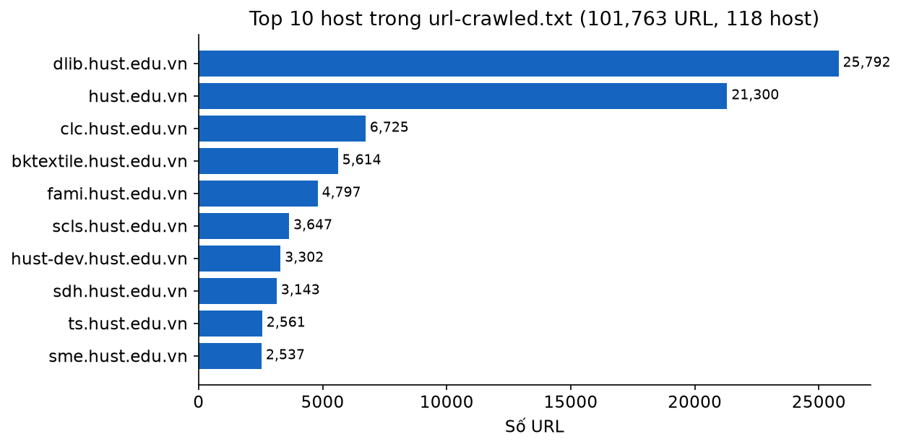 | 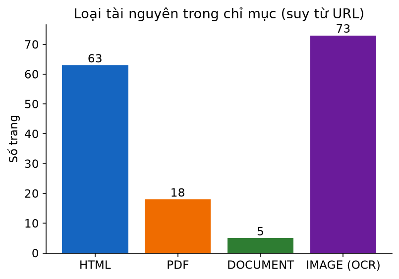 |
| 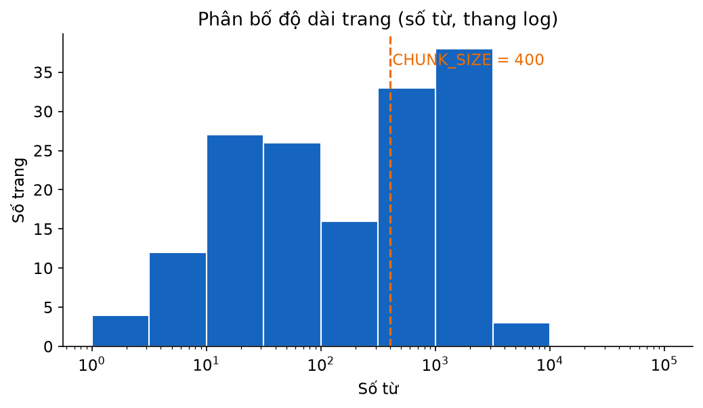 | 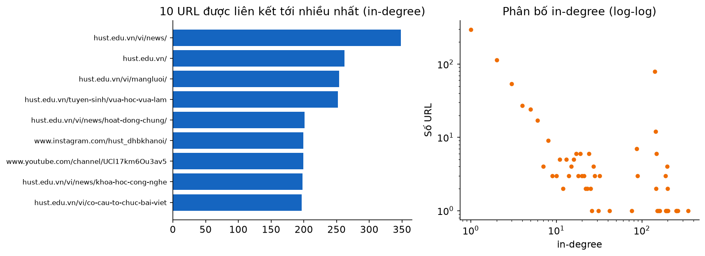 |

**Số liệu chính** *(chỉ mục mẫu trong repo: 159 trang → 564 document Lucene)*
- **Phạm vi:** `url-crawled.txt` có ~101,8 nghìn URL / **118 host**; 3 host đầu (`dlib`, `hust`, `clc`) chiếm **53%**.
- **Đa dạng định dạng:** HTML 63 · PDF 18 · Word 5 · **ảnh (OCR) 73** — tức **46% trang trong chỉ mục là ảnh được OCR** → OCR thực sự mở rộng độ phủ.
- **Độ dài trang:** trung vị **269 từ**, trung bình **684**, tối đa **9.747** (phân bố lệch phải); **68/159 trang (43%) > 400 từ** nên bị cắt chunk.
- **Đồ thị liên kết:** 21.760 cạnh từ 119 trang nguồn (TB ~183 link/trang) → 752 URL đích; in-degree lệch mạnh (đích phổ biến nhất **348** lần: trang chủ/menu) — dạng *heavy-tail*, phù hợp PageRank về sau.

---

## Slide 17 — So sánh Full-document vs Chunk-based
**Layout:** Two Content

| Tiêu chí | Full-document | Chunk-based |
|---|---|---|
| Đơn vị trả về | cả trang | đoạn liên quan nhất của trang |
| Số doc trong chỉ mục | 1 / trang | ⌈n/350⌉ / trang (bước 350 từ) |
| Chuẩn hóa độ dài (`norm`) | theo cả trang → trang dài bị phạt | theo ~400 từ → công bằng hơn |
| Snippet | có thể không chứa truy vấn | luôn bám đoạn khớp nhất |
| Truy vấn nhiều từ ở *xa nhau* | tốt (cả trang) | có thể trượt nếu từ nằm khác chunk |
| Chi phí chỉ mục | thấp | cao hơn (~ +chunk, overlap 12,5%) |
| Chồng lấn kết quả | không | **đã khử** — gộp theo URL, giữ điểm cao nhất |

**Thực nghiệm trên chỉ mục mẫu — 15 truy vấn, chạy lại đúng logic của `LuceneIndexService`** *(script: `docs/slide/analysis/Analyze.java`)*

| 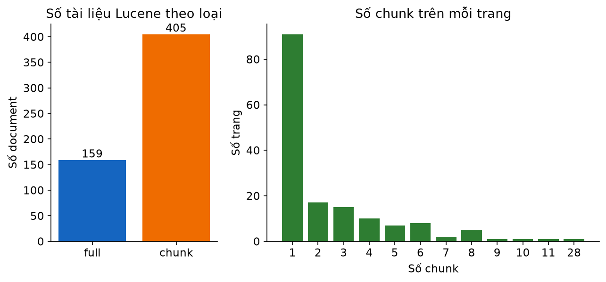 | 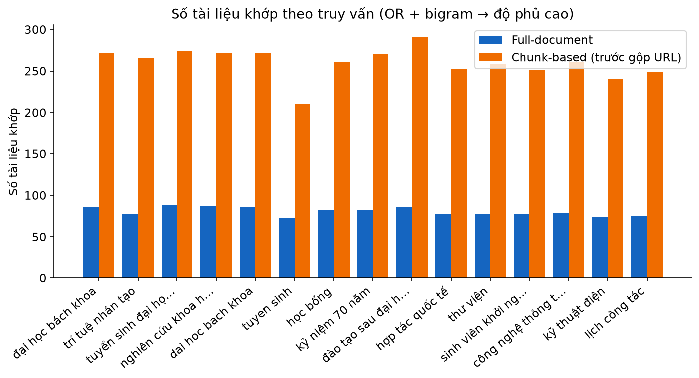 |
|---|---|
| 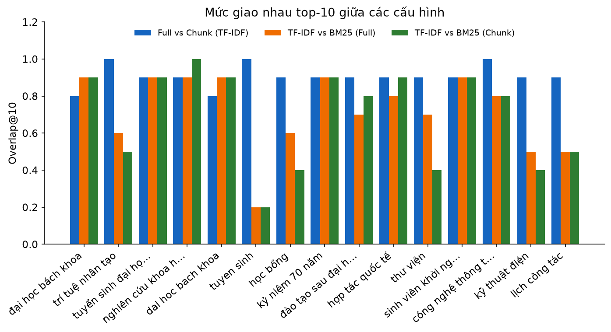 | 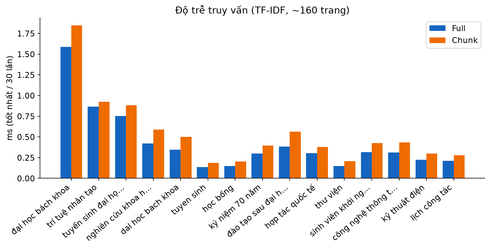 |

| Chỉ số | Kết quả | Diễn giải |
|---|---|---|
| Số document | 159 full vs **405 chunk** (TB 2,55 chunk/trang; 91 trang 1 chunk; 68 trang nhiều chunk; max 28) | Chunk làm chỉ mục lớn ~2,5× số đơn vị |
| Số document khớp | Full **72–88**, Chunk (trước gộp URL) **210–274** | OR + bigram → recall cao, kém chọn lọc (~54% trang khớp "đại học bách khoa") |
| Overlap@10 Full vs Chunk | **0,91** | Hai chế độ đồng thuận ở top đầu; khác nhau chủ yếu ở thứ hạng/snippet |
| Overlap@10 TF-IDF vs BM25 | **0,72** (full) · **0,69** (chunk) | Đổi mô hình làm đổi ~30% top-10 → cần đánh giá có nhãn |
| Độ trễ (best/30 lần, warm) | Full **0,43 ms** · Chunk **0,54 ms** | Chunk chậm hơn ~25% (do gộp URL), cả hai < 2 ms ở quy mô này |

> Lưu ý: overlap đo *mức đồng thuận*, **không phải độ chính xác**; chưa có nhãn liên quan. Độ trễ đo trên ~160 trang nên chỉ mang tính tham khảo.

**Cơ chế so sánh trong sản phẩm:** *cùng truy vấn – đổi `mode`* trên giao diện → thấy ngay khác biệt thứ hạng và snippet.

**Kết luận sơ bộ:** Chunk-based phù hợp tài liệu dài (PDF, văn bản quy định); Full-document phù hợp trang ngắn / truy vấn mang tính chủ đề chung.
*(Đã có phân tích định lượng *proxy* ở trên; chưa có Precision/Recall do chưa có nhãn — xem Slide 18.)*

---

## Slide 18 — Hạn chế & hướng phát triển
**Layout:** Two Content

**Hạn chế hiện tại (trung thực)**
1. **Chưa có đánh giá độ chính xác** (Precision/Recall, MAP, nDCG) — chưa có tập truy vấn & nhãn đúng. Mới có phân tích *proxy* (overlap@10, độ trễ, thống kê dữ liệu) ở Slide 16–17.
2. Ranking chỉ dựa **TF-IDF**; có đồ thị liên kết (`links.tsv`) nhưng **chưa dùng** (PageRank/HITS, anchor text).
3. Analyzer **bỏ dấu hoàn toàn**, chưa có stop-word, chưa tách từ tiếng Việt thật sự (bigram thay thế).
4. Crawler **đơn luồng**, chưa đọc `robots.txt`, chưa tải lại (re-crawl) theo độ tươi.
5. Mỗi lần index mở/đóng `IndexWriter` + `commit` → chậm khi nạp số lượng lớn.
6. Chưa phân trang, chưa highlight từ khóa, chưa autocomplete / sửa lỗi chính tả.
7. Chưa có kiểm thử tự động ngoài smoke test.

**Hướng phát triển**
- Xây **bộ đánh giá** (30–50 truy vấn, gán nhãn liên quan) → so sánh TF-IDF vs **BM25** (chỉ đổi `Similarity`) và full vs chunk bằng số liệu.
- Kết hợp **PageRank** + **anchor text** từ `links.tsv`.
- Tích hợp tách từ (VnCoreNLP) hoặc *giữ cả bản có dấu* làm trường phụ.
- Gộp `IndexWriter` dùng chung + batch commit; crawl đa luồng theo host.
- **Tìm kiếm ngữ nghĩa** (embedding) trên chunk + kết hợp lai (hybrid) với Lucene.

---

## Slide 19 — Tổng kết & đóng góp
**Layout:** Title Only

**Đã hoàn thành**
- ✅ Hệ thống **end-to-end**: crawl → trích xuất → lưu trữ → lập chỉ mục → tìm kiếm → giao diện web.
- ✅ **4 loại tài nguyên** (HTML, PDF, Word, ảnh-OCR) trên cả `hust.edu.vn` và tên miền con.
- ✅ **Analyzer tiếng Việt** tự cài đặt: chuẩn hóa, bỏ dấu, bigram.
- ✅ **2 chiến lược lập chỉ mục** (full/chunk) có thể đối chiếu trực tiếp.
- ✅ Crawler **lịch sự và bền bỉ**; có thể dừng/chạy tiếp.

**Con số:** ~3.500 dòng mã · 101.756 URL trong danh sách · 21.760 cạnh liên kết · chỉ mục Lucene ≈ 4,4 MB cho tập mẫu · 8 MB dữ liệu thô.

**Bài học:** (1) chất lượng *tiền xử lý & trích xuất nội dung* quyết định chất lượng tìm kiếm; (2) *đơn vị lập chỉ mục* (full vs chunk) ảnh hưởng trực tiếp đến xếp hạng; (3) cần **đánh giá định lượng** để kết luận.

**Phân công:** *[điền tên – phần việc]*

---

## Slide 20 — Hỏi & Đáp
**Layout:** Title Slide

# Cảm ơn thầy và các bạn đã lắng nghe!
### Q & A

- Mã nguồn: *[link repo]*
- Chạy thử: `mvn clean compile && mvn spring-boot:run` → http://localhost:8080
- Yêu cầu: JDK 21, MongoDB (`MONGODB_URI`, mặc định `mongodb://localhost:27017/information_retrieval`), thư mục `tessdata/` (vie + eng)

---

### Nguồn số liệu (không đưa lên slide)
| Số liệu | Lấy từ |
|---|---|
| 3.482 dòng (Java + template) | `wc -l` |
| 101.756 URL, 118 host | `sort -u url-crawled.txt` (top: `dlib.hust.edu.vn` 25.792; `hust.edu.vn` 21.300; `clc.hust.edu.vn` 6.725) |
| 21.760 cạnh / 752 đích duy nhất | `data/links.tsv` |
| 760 URL discovered | `data/url-discovered.txt` |
| Index 4,4 MB; data 8 MB | `du -sh` |
| 165/151/9 và bảng kết quả "đại học bách khoa" | ảnh `docs/images/ui` |

> ⚠️ `url-crawled.txt` là **file lịch sử/URL nạp sẵn (101 nghìn URL)**, *không* đồng nghĩa 101 nghìn trang đã vào chỉ mục. Chỉ mục mẫu hiện tại nhỏ (4,4 MB). Hãy nói đúng điều này khi thầy hỏi.

---
---

# PHẦN B — PHỤ LỤC

---

## Phụ lục P1 — Trích đoạn mã: Analyzer tiếng Việt
**Layout:** Title Only

```java
private static String normalize(String text) {
    String lower = text.toLowerCase(Locale.ROOT).replace('đ', 'd');
    return Normalizer.normalize(lower, Normalizer.Form.NFD)
            .replaceAll("\\p{M}+", "");          // bỏ dấu
}
// WORD_PATTERN = [\p{L}\p{N}]+
for (int i = 0; i < words.size(); i++) {
    expanded.add(words.get(i));                  // unigram
    if (i + 1 < words.size())
        expanded.add(new Token(words.get(i).text() + "_" + words.get(i+1).text(),
                               words.get(i).start(), words.get(i+1).end())); // bigram
}
```
**Ví dụ:** `"Tuyển sinh đại học"` → `tuyen, tuyen_sinh, sinh, sinh_dai, dai, dai_hoc, hoc`

---

## Phụ lục P2 — Trích đoạn mã: Truy vấn Lucene
**Layout:** Title Only

```java
MultiFieldQueryParser parser = new MultiFieldQueryParser(
        new String[]{"title","content"}, analyzer,
        Map.of("title", 2.0f, "content", 1.0f));
parser.setDefaultOperator(Operator.OR);

Query text = parser.parse(MultiFieldQueryParser.escape(queryText));
Query type = new TermQuery(new Term("documentType", documentType)); // full | chunk

Query q = new BooleanQuery.Builder()
        .add(text, BooleanClause.Occur.MUST)
        .add(type, BooleanClause.Occur.FILTER)   // lọc, không ảnh hưởng điểm
        .build();
searcher.setSimilarity(new ClassicSimilarity());  // TF-IDF
```

---

## Phụ lục P3 — Cấu hình hệ thống (`application.yml`)
**Layout:** Two Content

| Khóa | Giá trị | Ý nghĩa |
|---|---|---|
| `ir.crawler.allowed-domain` | `hust.edu.vn` | Miền (và subdomain) được phép |
| `ir.crawler.max-pages-per-run` | 1000 | Số tài nguyên xử lý tối đa/lượt |
| `ir.crawler.request-delay-ms` | 3000 | Khoảng cách giữa 2 request |
| `ir.crawler.max-retries` | 3 | Số lần thử lại với 429/5xx |
| `ir.crawler.retry-backoff-ms` | 5000 | Gốc của exponential backoff |
| `ir.crawler.content-extraction-strategy` | `READABILITY` | hoặc `DOM_HEURISTIC` |
| `ir.crawler.legacy-url-file` | `url-crawled.txt` | Lịch sử / nguồn nạp |
| `ir.storage.index-dir` / `data-dir` | `index` / `data` | Thư mục chỉ mục / dữ liệu |
| `spring.data.mongodb.uri` | `${MONGODB_URI:mongodb://localhost:27017/information_retrieval}` | Kết nối DB |

Backoff: lần thử 1 → 5 s, 2 → 10 s, 3 → 20 s.

---

## Phụ lục P4 — Ảnh minh họa dữ liệu MongoDB
**Layout:** Blank (3 ảnh)

- `docs/images/db_schema/image(1).png` — bản ghi **HTML** (title, publishDate, author, 170 links).
- `docs/images/db_schema/image.png` — bản ghi **IMAGE** (OCR ra chữ từ logo).
- `docs/images/db_schema/image(2).png` — bản ghi **DOCUMENT** (docx, metadata Tika).
- `docs/images/db_schema/image(3).png` — file `links.tsv` (đồ thị liên kết: nguồn ⇥ đích ⇥ anchor).

---

## Phụ lục P5 — Chuẩn bị cho câu hỏi của thầy (FAQ)
**Layout:** Title Only (không cần chiếu, để dự phòng)

| Câu hỏi dự kiến | Trả lời ngắn |
|---|---|
| Sao không dùng BM25? | Lucene 9 mặc định BM25; nhóm **chủ động đặt `ClassicSimilarity`** để bám lý thuyết TF-IDF của môn học. Đổi sang BM25 chỉ cần đổi 1 dòng `setSimilarity` — là hướng đánh giá tiếp theo. |
| Bỏ dấu có làm sai nghĩa không? | Có thể với từ đồng âm khác dấu; đổi lại được khả năng chịu lỗi gõ & gõ không dấu. Có thể bổ sung trường phụ giữ dấu. |
| Sao bigram mà không tách từ? | Tránh phụ thuộc thư viện ngoài, vẫn bắt được cụm 2 âm tiết. Hạn chế: cụm ≥3 âm tiết chỉ khớp qua các bigram liền kề. |
| Có tôn trọng `robots.txt` không? | Chưa cài đặt; bù bằng delay 3 s/request, đơn luồng, UA định danh, giới hạn miền, chỉ chạy học tập. Nằm trong hướng phát triển. |
| Đánh giá chất lượng ra sao? | Đã đo proxy trên 15 truy vấn: overlap@10 Full–Chunk = 0,91; TF-IDF–BM25 ≈ 0,7; độ trễ < 1 ms. Chưa có P/R/nDCG vì chưa có nhãn — đề xuất bộ truy vấn có nhãn. |
| Vì sao chunk 400 từ, overlap 50? | Tham số kinh nghiệm: đủ dài giữ ngữ cảnh, đủ ngắn để norm không phạt; overlap ~12,5% tránh mất cụm ở ranh giới. Chưa tinh chỉnh bằng thực nghiệm. |
| Mở `IndexWriter` mỗi lần có chậm không? | Có; chấp nhận được với quy mô vài nghìn tài liệu vì crawler bị giới hạn 3 s/request (I/O bound). Tối ưu: writer dùng chung + batch commit. |
| Tại sao lưu cả MongoDB lẫn Lucene? | Lucene = cấu trúc tìm kiếm, khó dùng làm kho gốc; MongoDB giữ bản gốc + đồ thị link để re-index / phân tích về sau. |
| Đồ thị liên kết dùng để làm gì? | Hiện mới lưu (21.760 cạnh); dự định PageRank & anchor text. |
| OCR có chính xác không? | Tốt với chữ in rõ như logo/thông báo; kết quả phụ thuộc chất lượng ảnh; trạng thái `SUCCESS/NO_TEXT/FAILED` được ghi trong metadata. |

## Phụ lục P6 — Thách thức kỹ thuật & cách giải quyết
**Layout:** Title Only (bảng 2 cột)

| Thách thức | Giải pháp trong code |
|---|---|
| Trùng URL do tham số tracking, `#`, cổng mặc định | `normalizeUrl()` chuẩn hóa trước mọi so sánh |
| Redirect ra ngoài miền | Kiểm tra **URL cuối** `isAllowedDomain(finalUrl)` |
| Vừa là URL yêu cầu vừa là URL cuối đã crawl | Ghi cả hai vào lịch sử, bỏ qua xử lý lại |
| Máy chủ chặn/quá tải (429/5xx) | Retry + exponential backoff + `Retry-After` |
| Trang nhiều nhiễu (menu, footer) | Loại thẻ nhiễu + chấm điểm link density / class-id |
| PDF/Word/ảnh | Tika + Tesseract OCR |
| Tiếng Việt: dấu & từ ghép | Bỏ dấu + unigram/bigram tự viết |
| Trang dài làm lệch điểm | Chunk 400 từ, overlap 50 |
| Kết quả trùng URL ở chunk mode | Gộp theo URL, giữ chunk tốt nhất |
| Index lại bị nhân bản | `updateDocument` / `deleteDocuments` trước khi thêm |
| Crawl lâu, UI không bị treo | Chạy nền bằng `ThreadPoolTaskExecutor`, poll `/status` |
| Lỗi ký tự đặc biệt trong truy vấn | `MultiFieldQueryParser.escape()` |

---

---

## Phụ lục P7 — Từ vựng, Zipf và đường cong điểm
**Layout:** Two Content

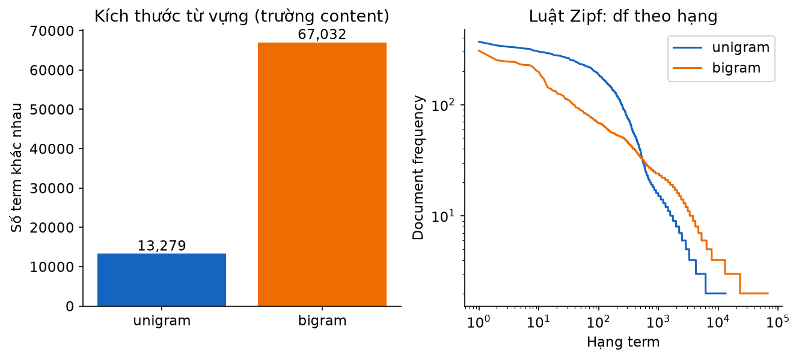

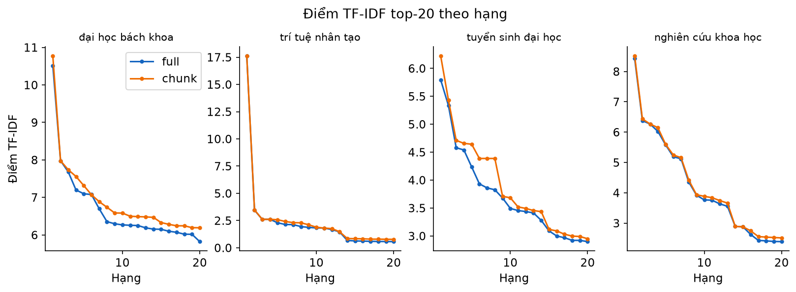

- **Bigram chiếm 83%** từ vựng (67.032/80.311) → chi phí lưu trữ chính của chiến lược "unigram + bigram"; đổi lại bắt được cụm 2 âm tiết.
- Cả hai nhóm term đều theo **luật Zipf** (đuôi dài): ít term rất phổ biến, rất nhiều term hiếm → IDF phân biệt tốt.
- Đường cong điểm top-20: giảm nhanh sau hạng 1–2 (trang chủ/trang khớp nhiều nhất vượt trội), full và chunk gần như chồng nhau ở các hạng sau.
- *(df của term luôn ≥ 2 vì mỗi trang có cả document full lẫn chunk — không phải lỗi.)*

---

## Phụ lục P8 — Sơ đồ lớp
**Layout:** Blank (ảnh lớn)

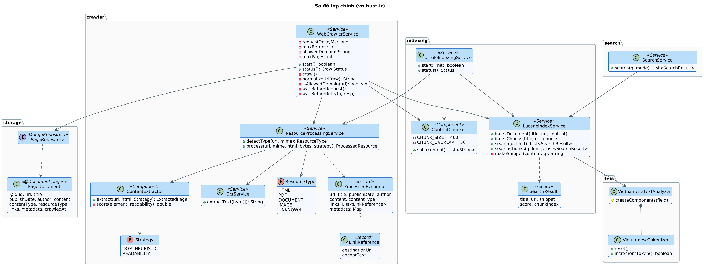

*`02_class_diagram.puml` — các lớp chính trong 5 package; `<<record>>` là Java record.*

---

## Phụ lục P9 — Sơ đồ use case
**Layout:** Two Content

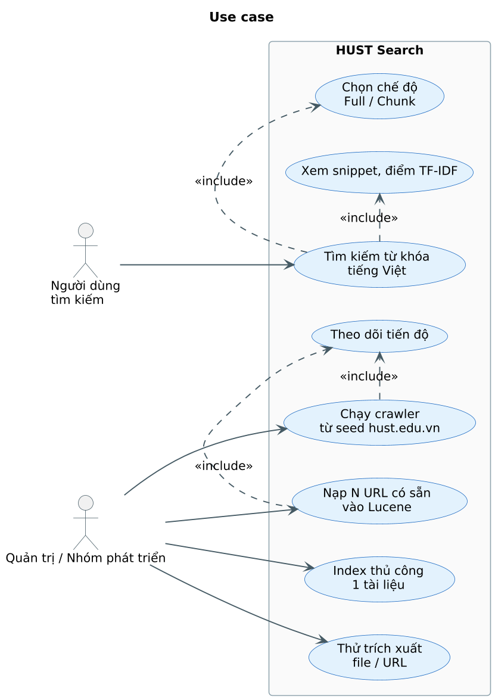

- **Người dùng:** tìm kiếm, chọn chế độ, xem snippet/điểm.
- **Quản trị/nhóm phát triển:** chạy crawler, nạp URL, index thủ công, thử trích xuất; cả hai luồng nạp đều theo dõi tiến độ (`<<include>>`).

---

## Phụ lục P10 — Danh sách file UML & cách sinh lại
**Layout:** Title Only

| File | Loại sơ đồ | Dùng ở |
|---|---|---|
| `01_architecture.puml` | Component | Slide 3 |
| `02_class_diagram.puml` | Class | P8 |
| `03_sequence_crawl.puml` | Sequence | Slide 13 |
| `04_sequence_search.puml` | Sequence | Slide 12 |
| `05_activity_crawler.puml` | Activity | Slide 5 |
| `06_activity_extraction.puml` | Activity | Slide 8 |
| `07_activity_analyzer.puml` | Activity | Slide 10 |
| `08_usecase.puml` | Use case | P9 |
| `09_data_model.puml` | Class (mô hình dữ liệu) | Slide 9 |
| `style.iuml` | Skin chung (`!include`) | tất cả |

```bash
cd docs/slide/diagrams && java -jar plantuml.jar -tpng -charset UTF-8 *.puml   # sinh PNG
cd docs/slide/analysis && java -cp ... Analyze index out && python charts.py   # sinh biểu đồ
```
(Chi tiết tại `docs/slide/analysis/README.md`.)

---
---

# PHẦN C — KỊCH BẢN THUYẾT TRÌNH

> Tổng thời lượng ước tính **~20–22 phút** (≈ 1 phút/slide; slide 5, 8, 10, 12 dài hơn; slide 3 và 15 có demo).
> Quy ước: **[Chuyển]** = câu nối sang slide kế · **[Thao tác]** = việc làm trên màn hình · *(thời gian)*.

---

### Slide 1 — Trang bìa *(0:20)*
"Em xin chào thầy. Hôm nay nhóm em xin báo cáo bài tập lớn môn Tìm kiếm thông tin với đề tài **HUST Search** — hệ thống thu thập, lập chỉ mục và tìm kiếm thông tin trên website của Đại học Bách khoa Hà Nội. Nhóm em gồm *[giới thiệu thành viên]*."

### Slide 2 — Bài toán & mục tiêu *(1:00)*
"Website hust.edu.vn và các tên miền con có rất nhiều nội dung: tin tức, thông báo, tài liệu, thư viện số. Điểm khó là nội dung không chỉ là HTML mà còn có PDF, Word và cả ảnh chứa chữ. Ngoài ra người dùng Việt thường gõ tiếng Việt có dấu lẫn không dấu.
Vì vậy nhóm đặt bốn mục tiêu: một, crawler thu thập có kiểm soát trong phạm vi hust.edu.vn; hai, trích xuất nội dung sạch từ nhiều định dạng; ba, xây chỉ mục ngược bằng Lucene với analyzer tiếng Việt do nhóm tự viết; bốn, làm giao diện tìm kiếm cho phép **so sánh hai chiến lược lập chỉ mục: toàn văn bản và theo đoạn**. Đây cũng là điểm nhóm em muốn nhấn mạnh trong bài này."
**[Chuyển]** "Em xin trình bày kiến trúc tổng thể."

### Slide 3 — Kiến trúc *(1:30)*
"Hệ thống là một ứng dụng Spring Boot, chia ba lớp. Lớp **thu thập**: WebCrawlerService đi từ trang chủ, tải về bằng Jsoup. Lớp **xử lý và lưu trữ**: ResourceProcessingService nhận byte và loại nội dung, rồi chọn cách xử lý — HTML thì qua ContentExtractor, PDF và Word qua Apache Tika, ảnh thì qua Tesseract OCR. Kết quả được lưu bản gốc vào MongoDB cùng đồ thị liên kết ra file. Lớp **lập chỉ mục và tìm kiếm**: nội dung vừa được lập chỉ mục nguyên bản, vừa được cắt thành chunk rồi lập chỉ mục riêng vào Lucene. Phía người dùng, trình duyệt gọi HomeController, SearchService truy vấn Lucene và trả về trang Thymeleaf."
**[Chuyển]** "Về công nghệ cụ thể…"

### Slide 4 — Công nghệ & cấu trúc mã *(0:45)*
"Bảng này tóm tắt công nghệ: Spring Boot cho web, Jsoup cho HTML, Tika cho PDF/Word, Tess4J cho OCR tiếng Việt và Anh, MongoDB làm kho gốc và Lucene 9.12 làm bộ máy tìm kiếm. Mã nguồn khoảng 3.500 dòng, tổ chức theo package crawler, indexing, text, search, storage và web — mỗi package một trách nhiệm."
**[Chuyển]** "Đi vào từng thành phần, trước hết là crawler."

### Slide 5 — Crawler: thuật toán *(1:30)*
"Crawler duyệt theo **chiều rộng**, dùng ArrayDeque làm hàng đợi. Bắt đầu từ seed hust.edu.vn, với mỗi URL em kiểm tra ba điều: đã thử trong lượt này chưa, đã nằm trong lịch sử chưa, có thuộc miền hust.edu.vn hay subdomain không. Sau khi tải xong, em kiểm tra miền **một lần nữa trên URL cuối cùng**, vì có thể bị redirect ra ngoài.
Một việc quan trọng là **chuẩn hóa URL** để không crawl trùng: đưa về chữ thường, bỏ cổng mặc định, bỏ fragment và các tham số theo dõi như utm, fbclid, gclid.
Trạng thái được ghi ra file nên dừng đi chạy lại vẫn tiếp tục được, không bắt đầu lại từ đầu."
**[Chuyển]** "Crawl thì phải lịch sự với máy chủ."

### Slide 6 — Crawler: lịch sự & bền bỉ *(1:15)*
"Nhóm em đặt khoảng cách tối thiểu **3 giây giữa hai request**, dùng khóa đồng bộ để đảm bảo điều này, thêm User-Agent tự khai báo là bot học thuật, và executor chỉ có **một luồng** nên không thể crawl dồn dập.
Khi gặp lỗi 429 hoặc 5xx, crawler thử lại tối đa ba lần với **exponential backoff**: 5 giây, 10 giây, 20 giây, và tôn trọng header Retry-After. Lỗi ở một URL không làm sập cả phiên.
Em xin nói thẳng một hạn chế: hiện nhóm **chưa đọc robots.txt**; thay vào đó dựa vào giới hạn tốc độ, đơn luồng và phạm vi miền. Việc này nằm trong hướng phát triển."
**[Chuyển]** "Sau khi tải về, mỗi loại tài nguyên được xử lý khác nhau."

### Slide 7 — Đa định dạng *(1:15)*
"Hệ thống nhận diện loại tài nguyên bằng MIME rồi đến đuôi file. HTML đi qua bộ trích xuất riêng. PDF và Word đi qua Tika. Ảnh thì trích metadata bằng Tika và **chạy OCR Tesseract với mô hình tiếng Việt cộng tiếng Anh**.
Các ví dụ thật nằm trong MongoDB: logo của trường được OCR ra đúng dòng 'Đại học Bách khoa Hà Nội — Hanoi University of Science and Technology'; một file docx về chương trình Erasmus được lấy đúng tiêu đề, tác giả và ngày tạo từ metadata; một bài tin có tới 170 liên kết ra. Nhờ vậy ảnh chứa chữ cũng tìm được bằng từ khóa."
**[Chuyển]** "Với HTML, thử thách lớn nhất là tách nội dung chính khỏi nhiễu."

### Slide 8 — Trích xuất nội dung HTML *(1:45)*
"Một trang web có menu, footer, banner… nếu đưa hết vào chỉ mục thì từ như 'trang chủ', 'liên hệ' sẽ xuất hiện ở mọi nơi và làm nhiễu kết quả.
Quy trình: lấy metadata theo thứ tự ưu tiên, ví dụ tiêu đề lấy từ og:title rồi mới đến h1 và title; trích liên kết; sao chép DOM và **xóa các thẻ nhiễu** như nav, footer, aside, script; rồi **chấm điểm từng khối** để chọn khối nội dung chính.
Công thức điểm là logarit độ dài văn bản, cộng 2 điểm mỗi đoạn p, cộng 1,5 điểm mỗi tiêu đề, **trừ 12 lần mật độ liên kết**. Trực giác là: nội dung chính có nhiều chữ, nhiều đoạn văn và ít liên kết; còn menu thì toàn liên kết. Chiến lược Readability còn cộng điểm cho thẻ article và main, cộng khi class có chữ 'content', 'post', và trừ nặng khi có 'nav', 'sidebar', 'footer', 'widget'. Nếu không chọn được khối nào, hệ thống lùi về lấy toàn bộ body."
**[Chuyển]** "Dữ liệu sau trích xuất được lưu như sau."

### Slide 9 — Lưu trữ *(1:00)*
"Mỗi tài nguyên được lưu thành một document trong MongoDB, lấy **URL làm khóa** nên lưu lại sẽ ghi đè chứ không nhân bản. Bản ghi có tiêu đề, tác giả, ngày đăng, nội dung, loại tài nguyên, danh sách liên kết và metadata.
Bên cạnh đó có ba file phẳng: links.tsv lưu đồ thị liên kết với hơn **21 nghìn cạnh**; url-discovered lưu các URL đã phát hiện; và url-crawled là lịch sử, với hơn 101 nghìn URL thuộc 118 host.
Lý do tách Mongo và Lucene: Mongo giữ bản gốc đầy đủ để có thể lập chỉ mục lại bất cứ lúc nào; Lucene chỉ giữ cấu trúc phục vụ tìm kiếm."
*(Lưu ý: nếu thầy hỏi, nói rõ 101 nghìn là danh sách URL, không phải số trang đã nằm trong chỉ mục.)*
**[Chuyển]** "Phần cốt lõi của môn học là chỉ mục và xếp hạng, bắt đầu với xử lý tiếng Việt."

### Slide 10 — Analyzer tiếng Việt *(1:45)*
"Nhóm tự viết một Analyzer và Tokenizer cho tiếng Việt, gồm bốn bước. Một, chuyển chữ thường và đổi 'đ' thành 'd'. Hai, chuẩn hóa Unicode NFD rồi **bỏ toàn bộ dấu**. Ba, tách từ bằng biểu thức chính quy chữ và số. Bốn, **sinh thêm bigram** nối các từ liền kề.
Ví dụ 'Đại học Bách khoa' thành 'dai, dai_hoc, hoc, hoc_bach, bach, bach_khoa, khoa'.
Vì sao làm vậy? Bỏ dấu để người dùng gõ 'dai hoc bach khoa' vẫn tìm ra, và không bị ảnh hưởng bởi khác biệt dạng Unicode. Còn bigram là cách nhóm xử lý việc tiếng Việt viết cách chữ: 'đại học' là một từ nhưng gồm hai âm tiết. Bigram giúp giữ được cụm từ mà **không cần thư viện tách từ ngoài**. Cùng một analyzer được dùng cho cả lúc lập chỉ mục và lúc truy vấn nên token luôn khớp.
Đánh đổi là mất khả năng phân biệt từ khác dấu, và chỉ mục lớn hơn do nhiều token."
**[Chuyển]** "Trên nền analyzer đó, nhóm lập chỉ mục theo hai cách."

### Slide 11 — Hai chiến lược lập chỉ mục *(1:30)*
"Trong cùng một chỉ mục Lucene có hai loại document, phân biệt bằng trường documentType. Loại **full** là cả trang, khóa là URL. Loại **chunk** là từng đoạn khoảng 400 từ, với khóa là URL cộng số thứ tự chunk.
Việc cắt dùng cửa sổ trượt **400 từ, chồng lấn 50 từ**. Lý do cần chunk: công thức TF-IDF của Lucene chuẩn hóa theo độ dài trường, nên trang rất dài bị phạt nặng; cắt thành đoạn giúp so sánh công bằng hơn và cho phép trả về **đúng đoạn liên quan**. Phần chồng lấn tránh cắt đứt một cụm từ ngay tại ranh giới.
Cập nhật là idempotent: full dùng updateDocument theo URL, chunk thì xóa chunk cũ của URL rồi thêm lại, nên không có bản sao hay chunk mồ côi."
**[Chuyển]** "Còn khi người dùng gõ truy vấn thì sao?"

### Slide 12 — Truy vấn & xếp hạng *(1:45)*
"Truy vấn được phân tích bằng MultiFieldQueryParser trên hai trường, **tiêu đề được nhân đôi trọng số** vì tiêu đề thường mô tả tốt nhất nội dung. Toán tử mặc định là OR để ưu tiên độ phủ; tài liệu khớp càng nhiều từ và bigram thì điểm càng cao. Em có escape ký tự đặc biệt để người dùng gõ gì cũng không gây lỗi cú pháp. Loại tài liệu full hay chunk được đưa vào như một FILTER nên không ảnh hưởng điểm.
Về mô hình xếp hạng, nhóm **chủ động chọn ClassicSimilarity — tức TF-IDF theo mô hình không gian vector** — thay vì BM25 mặc định, để bám đúng lý thuyết đã học. Điểm là tổng trên các term của tf nhân idf bình phương nhân boost nhân norm. Giao diện hiển thị nhãn TF-IDF để thấy đúng mô hình.
Ở chế độ chunk, nhiều chunk có thể cùng thuộc một trang, nên hệ thống lấy nhiều ứng viên hơn rồi **gộp theo URL và giữ chunk điểm cao nhất**. Snippet được cắt quanh vị trí cụm truy vấn, so khớp sau khi bỏ dấu."
**[Chuyển]** "Tổng hợp lại, đây là luồng nạp dữ liệu."

### Slide 13 — Pipeline nạp dữ liệu *(0:45)* — dùng sequence diagram
"Mỗi URL đi qua chuỗi: giãn cách 3 giây, tải có retry, kiểm tra miền–trạng thái–loại, xử lý theo định dạng, rồi lưu Mongo, lập chỉ mục full, cắt chunk và lập chỉ mục chunk, ghi lịch sử, cuối cùng ghi liên kết và đẩy các link nội miền mới vào hàng đợi. Có hai chế độ: crawl khám phá từ seed, hoặc nạp sẵn N URL từ file để dựng nhanh chỉ mục mẫu. Chỉ tài nguyên có nội dung chữ mới vào Lucene."
**[Chuyển]** "Giờ em xin demo giao diện."

### Slide 14 — API & giao diện *(0:45)*
"Hệ thống có API REST để điều khiển crawler, nạp URL, index thủ công và một endpoint để thử trích xuất bất kỳ file hay URL nào — rất tiện cho gỡ lỗi. Giao diện có ba khối: nạp URL có sẵn, crawler với thanh tiến độ trực tiếp, và khối tìm kiếm với **công tắc đổi giữa Full-document và Chunk-based** cùng vài truy vấn gợi ý."
**[Thao tác]** *Chuyển sang trình duyệt (hoặc dùng ảnh nếu không demo trực tiếp).*

### Slide 15 — Demo & kết quả *(1:45)*
**[Thao tác]** Gõ "đại học bách khoa", mode Chunk → rồi đổi sang Full-document. Có thể thử thêm "dai hoc bach khoa" (không dấu) và "tuyển sinh đại học".
"Đây là crawler đang chạy: đã xử lý 165 tài nguyên, lập chỉ mục 151, lỗi 9. Với truy vấn 'đại học bách khoa' ở chế độ chunk, hệ thống trả 20 kết quả. Đứng đầu là trang chủ với điểm 11,3, chunk số 4 — snippet cho thấy đoạn đó nói đúng về Đại học Bách khoa Hà Nội. Thứ hai là bài tin kỷ niệm 70 năm thành lập, thứ ba là Trung tâm Sáng tạo và Khởi nghiệp thuộc tên miền con bke.hust.edu.vn — chứng tỏ crawler đã đi qua các subdomain.
Em thử gõ không dấu thì vẫn cho cùng kết quả, đúng như thiết kế analyzer."
*(Nếu live demo lỗi: dùng ảnh `docs/images/ui/image(3).png`.)*
**[Chuyển]** "Bây giờ, so sánh hai chiến lược."

### Slide 16 — Phân tích tập dữ liệu *(1:15)*
"Trước khi so sánh hai chiến lược, em xin nói về dữ liệu. Danh sách URL của nhóm trải trên **118 host**, ba host lớn nhất chiếm hơn một nửa. Chỉ mục mẫu trong repo gồm **159 trang**, trong đó **73 trang — 46% — là ảnh được OCR**, 63 trang HTML, 18 PDF và 5 Word; như vậy OCR thực sự mở rộng phạm vi tìm kiếm.
Về độ dài: trung vị 269 từ nhưng trung bình 684 và dài nhất gần 10 nghìn từ, tức phân bố lệch phải; **43% số trang dài hơn 400 từ** nên bị cắt chunk — đó là lý do chiến lược chunk có ý nghĩa.
Đồ thị liên kết có hơn 21 nghìn cạnh nhưng chỉ 752 đích khác nhau, phân bố in-degree đuôi dài: vài trang như trang chủ được trỏ tới 348 lần. Đây là nền cho PageRank về sau."
**[Chuyển]** "Giờ em so sánh hai chiến lược bằng số liệu."

### Slide 17 — So sánh Full vs Chunk *(1:45)*
"Về lý thuyết: full-document cho mỗi trang một document, còn chunk thì mỗi trang nhiều document, mỗi đoạn có độ dài gần như nhau nên chuẩn hóa độ dài công bằng hơn và **snippet luôn bám đoạn khớp nhất**. Đổi lại chi phí chỉ mục cao hơn, và nếu truy vấn có nhiều từ nằm ở hai đoạn xa nhau thì chunk có thể bỏ lỡ, trong khi full-document vẫn bắt được. Kết quả chunk đã được gộp theo URL nên người dùng không thấy lặp.
Nhóm đã chạy lại đúng logic truy vấn trên 15 câu hỏi. Chỉ mục có 159 document full và **405 chunk**, trung bình 2,55 chunk mỗi trang. Mỗi truy vấn khớp khoảng 54% số trang vì ta dùng toán tử OR và bigram — độ phủ cao nhưng chưa chọn lọc. **Top-10 của hai chế độ trùng nhau 91%**, nghĩa là hai cách đồng thuận ở những kết quả đầu, khác nhau chủ yếu ở snippet và thứ hạng phía sau. Khi thử đổi TF-IDF sang BM25, top-10 chỉ trùng khoảng 70%, tức đổi mô hình ảnh hưởng đáng kể. Độ trễ dưới 1 mili-giây ở quy mô này; chunk chậm hơn khoảng 25% do bước gộp theo URL.
Em xin nói rõ: độ trùng lặp chỉ cho biết mức đồng thuận chứ **không phải độ chính xác**; nhóm chưa có nhãn liên quan nên chưa tính được Precision/Recall."
**[Chuyển]** "Trong quá trình làm, nhóm gặp một số thách thức."

### Slide 18 — Hạn chế & hướng phát triển *(1:30)*
"Em xin trình bày trung thực. **Một, chưa có đánh giá định lượng** như Precision, Recall hay nDCG vì chưa có bộ truy vấn có nhãn. **Hai,** xếp hạng mới chỉ dựa TF-IDF; nhóm đã lưu đồ thị liên kết nhưng chưa dùng để tính PageRank. **Ba,** analyzer bỏ dấu hoàn toàn và chưa có stop-word hay tách từ thật. **Bốn,** crawler đơn luồng và chưa đọc robots.txt. **Năm,** mỗi lần index mở và đóng một IndexWriter nên chậm khi nạp lớn.
Hướng tiếp theo: xây bộ 30–50 truy vấn có nhãn rồi so sánh TF-IDF với BM25, full với chunk bằng số liệu; kết hợp PageRank và anchor text; tích hợp tách từ tiếng Việt; tối ưu writer; và mở rộng sang tìm kiếm ngữ nghĩa bằng embedding kết hợp với Lucene."
**[Chuyển]** "Em xin tổng kết."

### Slide 19 — Tổng kết *(1:00)*
"Nhóm đã xây được hệ thống đầy đủ từ thu thập, trích xuất, lưu trữ, lập chỉ mục đến giao diện tìm kiếm; xử lý được bốn loại tài nguyên kể cả ảnh bằng OCR; tự viết analyzer tiếng Việt; và cho phép so sánh trực tiếp hai chiến lược lập chỉ mục. Qua bài tập, nhóm rút ra ba điều: chất lượng trích xuất nội dung quyết định chất lượng tìm kiếm; đơn vị lập chỉ mục ảnh hưởng trực tiếp đến xếp hạng; và muốn kết luận chắc chắn thì cần đánh giá định lượng. *[Nêu phân công nếu cần.]*"

### Slide 20 — Q&A *(còn lại)*
"Em xin cảm ơn thầy đã lắng nghe. Nhóm em sẵn sàng trả lời câu hỏi của thầy ạ."
**[Gợi ý]** Mở sẵn **Phụ lục P5 (FAQ)**; nếu thầy hỏi mã nguồn → P1, P2; hỏi cấu hình → P3; hỏi dữ liệu → P4.

---

### Mẹo trình bày
- **Phân vai** (nếu nhiều người): Người 1 — Slide 1–4, 19–20 · Người 2 — Slide 5–9, 13 · Người 3 — Slide 10–12, 14–16 · Người 4 — Slide 17–18 + điều khiển demo.
- **Trước giờ báo cáo:** chạy MongoDB, `mvn spring-boot:run`, thử 3 truy vấn gợi ý ở cả hai mode; chuẩn bị ảnh dự phòng.
- **3 câu cần nhớ khi bị hỏi dồn:** (1) "nhóm chọn TF-IDF để bám môn học, đổi BM25 chỉ một dòng"; (2) "chưa có đánh giá định lượng, đây là bước tiếp theo"; (3) "101 nghìn là danh sách URL, không phải số trang đã lập chỉ mục".
